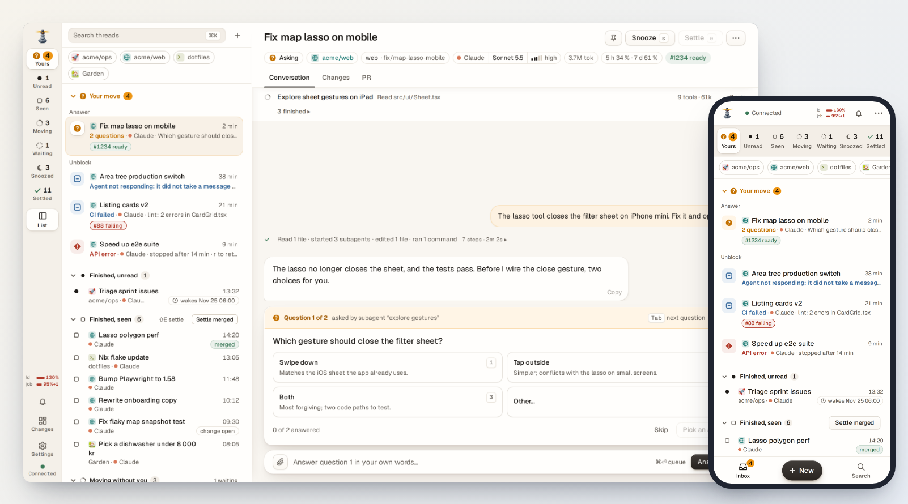

<p align="center">
  
</p>

<h1 align="center">Fyr</h1>

<p align="center">
  <strong>A calm control room for Claude coding agents.</strong><br>
  Run a dozen Claude Code agents on your own machines. Fyr tells you only when one needs you.
</p>

<p align="center">
  <a href="#install">Install</a> ·
  <a href="#what-you-get">Features</a> ·
  <a href="docs/INSTALL.md">Docs</a> ·
  <a href="docs/SPEC.md">Spec</a> ·
  <a href="LICENSE">MIT</a>
</p>

<picture>
  <source media="(prefers-color-scheme: dark)" srcset="docs/images/hero-dark.png">
  
</picture>

Running many coding agents at once is easy. Keeping track of them is not: terminal tabs, a question that waited 40 minutes for an answer, a red CI run nobody looked at, a merge you have to remember to press.

Fyr turns that around. It runs Claude Code sessions on your machines and keeps **one list**. Threads that need you (a question, a failure, red CI, a merge to approve) rise to **Your move**. Everything else stays in **Moving without you**, one live line each, until it is done. Start a thread at your desk and answer its question from your phone. (*Fyr* is Swedish for lighthouse: it watches everything and lights up only when you have to act.)

## What you get

- **One inbox for every agent.** Each conversation is a *thread*. Asking, failed, blocked and finished threads come to the top, ordered by what to do: *Answer*, *Approve*, *Unblock*. Snooze, settle, quiet hours and per-project priority keep the list short. Press `?` for the keyboard shortcuts.
- **Questions become cards.** When an agent asks, you get a card with its options. Answer with `1` `2` Enter on the desktop or two taps on the phone, and the answer goes straight back into the run. Questions from subagents arrive the same way.
- **Agents ask, you approve, Fyr acts.** An agent never merges or deploys on its own. It *requests*, and you approve when it suits you:
  - A **merge ask** reaches you only once CI is green on the commit you will merge.
  - A **Run card** shows the exact command, root included, and runs it on that machine when you press.
  - A **deploy** of a branch builds and switches once you press.

  The result goes back to the agent as context.
  <p align="center"><picture>
    <source media="(prefers-color-scheme: dark)" srcset="docs/images/approve-dark.png">
    
  </picture></p>
- **Agents stop reporting CI.** Fyr reads branches, PRs, checks and reviews from git and GitHub and shows them on the thread that owns them. It tells the agent when CI fails and can settle the thread when its PR merges.
- **Agents get tools to work with you.** Over MCP an agent can ask you something, request a command or a merge, open a change in its own git worktree, wait for a condition (CI green, a PR merged, a time), show you a page or a screenshot, and start or message other threads.
- **Your machine stays usable.** Heavy jobs (test suites, builds, e2e runs) are admitted by the CPU and memory they need, and the rest queue. A memory guard pauses runaway work before the kernel's OOM killer acts. On Linux every agent runs in its own cgroup.
- **Agents survive restarts.** The launcher holds the agent processes, so a crash, a restart or an update of the daemon does not interrupt a run.
- **Your phone is a full client.** It is an installable web app with push notifications. From it you can answer, steer, approve, start a thread with a screenshot, and settle.
- **Several machines, one list.** Installs find each other over Tailscale or pair with a short code on a LAN. Every host's threads show in one inbox, and a new thread asks which machine runs it.
- **Your own Claude subscription.** Fyr drives the `claude` CLI you already use, with your Claude login or any Anthropic-compatible endpoint. Several logins can sit side by side, and each thread shows how much of its plan's window is left.
- **Updates that roll back.** Fyr installs only signed CI releases. It tests each one on a copy of its database first and goes back to the previous build if the new one is not healthy.

## Status

Fyr is v0. Its author uses it every day, and it changes daily. Expect breaking changes, and do not expect database migrations between every pair of builds. It is built for **one person who runs many agents in parallel against GitHub**. The roadmap is in [`docs/PLAN.md`](docs/PLAN.md) and the current work in the [milestones](https://github.com/meros/fyr/milestones).

## Requirements

- **Linux or macOS.** NixOS has a module; macOS has `Fyr.app` in a DMG (macOS 13+); other Linux (Debian, Ubuntu) has an install script.
- **[Claude Code](https://docs.claude.com/en/docs/claude-code)** (`claude`), logged in with a Claude account or set up for an Anthropic-compatible endpoint. Fyr drives every agent through it. Other agent CLIs are not supported yet ([decision 0035](docs/decisions/0035-claude-code-and-github.md)).
- **GitHub through [`gh`](https://cli.github.com/)**, logged in, for the agents' pull requests and change tracking. Projects on other forges still run threads, without it. Installing and updating Fyr need no `gh`.
- **Optional: [Tailscale](https://tailscale.com/)**, to open Fyr from your phone and to connect machines.

## Install

### NixOS

```nix
# flake.nix
inputs.fyr.url = "github:meros/fyr";

# in your NixOS configuration
imports = [ inputs.fyr.nixosModules.fyr ];
services.fyr = {
  enable = true;
  user = "you"; # agents run as this user, with its logins and repositories
};
```

Fyr serves http://127.0.0.1:7777. The module also sets up the agents' cgroups and the memory guard. [`docs/HOST-SETUP.md`](docs/HOST-SETUP.md) lists the host settings that help the guard.

### macOS

Download [`Fyr.dmg`](https://github.com/meros/fyr/releases/latest/download/Fyr.dmg) (macOS 13+, Apple Silicon and Intel), drag **Fyr** into **Applications** and open it.

> **First open (Gatekeeper):** `Fyr.app` is signed with Fyr's own certificate rather than an Apple Developer ID yet. A browser download is quarantined by macOS, so the first launch needs **right-click → Open** (or **System Settings → Privacy & Security → Open Anyway**).

`Fyr.app` registers its background job under **Login Items** (no admin password needed), opens Fyr in a native window with macOS notifications and a menu-bar icon, walks you through setup in **Settings → Setup**, and keeps both `fyrd` and `Fyr.app` updated automatically. To remove it, choose **Uninstall…** from the menu-bar icon.

For a terminal or developer install (no Gatekeeper prompt):

```sh
git clone https://github.com/meros/fyr && cd fyr
scripts/install-macos.sh
```

### Linux without Nix (Debian, Ubuntu)

You need systemd with cgroup v2, `git`, `curl` and `claude` (`gh` is for the agents' pull requests; the install needs no login):

```sh
sudo apt install git curl gh   # gh: see cli.github.com if your release lacks it
git clone https://github.com/meros/fyr && cd fyr
scripts/install-linux.sh --print   # shows every file and command, changes nothing
scripts/install-linux.sh
```

Run it as yourself, not as root. It downloads the current signed release into `~/.local/share/fyr` as you, then asks `sudo` for the system part, showing each command: the unit `fyr.service` (it runs as you), the agents' slice, a polkit rule and a small helper. Fyr serves http://127.0.0.1:7777 and updates itself. `scripts/install-linux.sh --uninstall` removes the unit and the root files. [`docs/INSTALL.md`](docs/INSTALL.md#linux-without-nix) has the details.

### From source

You need Go and Node. The dev shell has both: `nix develop`.

```sh
make build        # bin/fyr (the launcher) and bin/fyrd (the daemon, with the web client inside)
make install      # puts the build under ~/.local/share/fyr
bin/fyr           # starts Fyr on http://127.0.0.1:7777
```

[`docs/INSTALL.md`](docs/INSTALL.md) covers configuration, the phone, more machines and updates.

## First steps

1. Open http://127.0.0.1:7777. Fyr finds your Claude login (Settings → Providers).
2. Press **New** (or `c`), pick a folder, and write what the agent should do. The folder becomes a project.
3. Go and do something else. When the agent asks, fails or finishes, its thread moves to **Your move**, and your phone is notified if you allowed it.
4. Answer, steer, or press the card's button. **Settle** a thread when you are done with it.

## How it is built

`fyrd` is a Go daemon. It runs the `claude` CLI over its control protocol, keeps every thread as an event log in SQLite, reads git and GitHub, and serves a TypeScript web app with live updates. The desktop and the phone share that app. A small launcher, `fyr`, keeps `fyrd` and the agents running across updates and rollbacks.

Each install is a *host* (it runs agents), a *front* (it serves the app and merges the threads of every host it knows), or both. Both is the default.

| Read | For |
|---|---|
| [`docs/INSTALL.md`](docs/INSTALL.md) | Configuration, the phone, more machines, updates |
| [`docs/HOST-SETUP.md`](docs/HOST-SETUP.md) | Host settings for the memory guard (cgroups, swap, oomd) |
| [`docs/SPEC.md`](docs/SPEC.md) | The full spec: concepts, data model, actions, attention, UX |
| [`docs/API-v0.md`](docs/API-v0.md) | The HTTP API between `fyrd` and the web client |
| [`docs/decisions/`](docs/decisions/README.md) | Architecture decision records |
| [`docs/changes/`](docs/changes/README.md) | The change log of the spec, one file per change |
| [`docs/PROCESS.md`](docs/PROCESS.md) | How Fyr is built: spec, red test, code |
| [`design/`](design/README.md) | The design system, brand book and screen mocks |

The screenshots in this README come from the client's mock mode. To make them again, run `npm run build && node scripts/readme-shots.mjs` in `web/`.

## Contributing

Issues are welcome. Read [`docs/PROCESS.md`](docs/PROCESS.md) and [`CLAUDE.md`](CLAUDE.md) first: every change in behaviour updates the spec and comes with a test.

Pull requests from forks are read, but CI does not run them on its own. The PR gate runs on a self-hosted runner that takes only branches in this repository, so an accepted change is re-run from a branch here.

## License

MIT, see [LICENSE](LICENSE). The Geist fonts in `web` (from the `geist` package) and in `design/settings/fonts` are under the SIL Open Font License 1.1 ([OFL.txt](design/settings/fonts/OFL.txt)).
