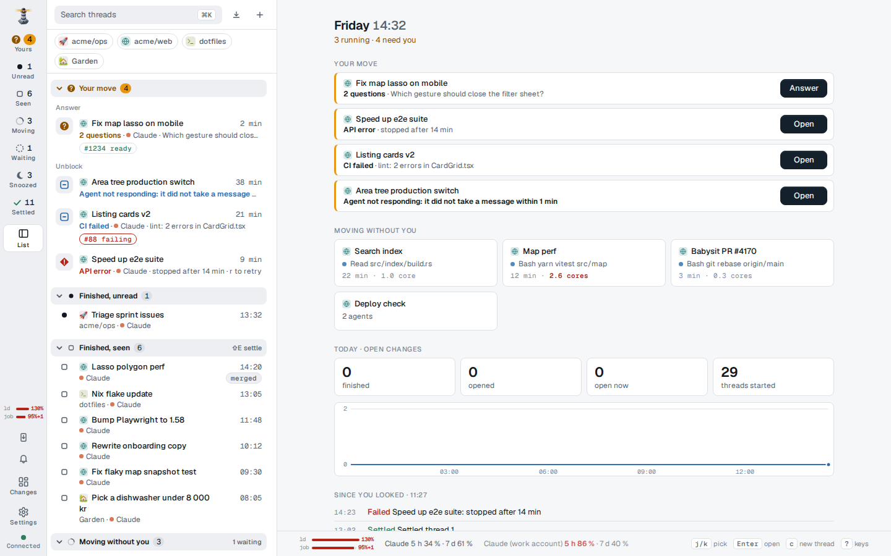
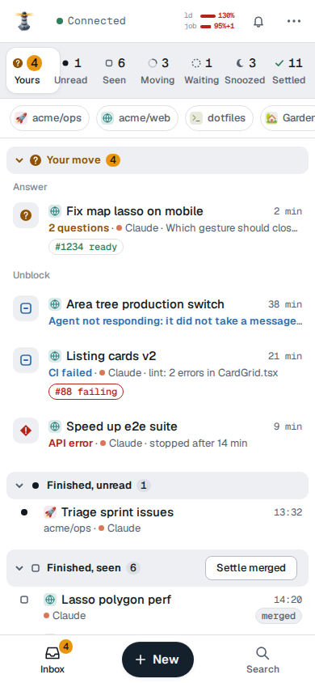

# Fyr

**A calm control room for Claude coding agents.** Fyr runs Claude Code sessions on your own machines and gives you one list: what needs you on top, the work that moves without you below. Like a lighthouse (*fyr* in Swedish), it watches everything and shines only when you must act.

<picture>
  <source media="(prefers-color-scheme: dark)" srcset="docs/images/inbox-dark.png">
  
</picture>

Fyr is built for one person who runs many agents in parallel against GitHub, from a desktop and a phone.

## What it does

- **One inbox for every agent.** Each conversation with an agent is a *thread*. A thread that asks a question, fails, waits on CI or finishes rises to **Your move**. The rest stay in **Moving without you**, one live line each. Snooze, settle and quiet hours keep the list short.
- **Questions arrive as cards.** An agent's question is a card with its options, answered with one press on the desktop or the phone, and the answer goes back into the run.
- **Agents ask, you approve, Fyr acts.** Merges, deploys and commands an agent cannot run alone become requests: a merge ask waits until CI is green on the head you saw, a Run card shows the exact command, and the result goes back to the agent as context. Agents get Fyr's tools over MCP for this: ask, run a command, open a change, watch CI, show a page, start another thread.
- **Changes are tracked for you.** Branches, PRs, checks and reviews are read from git and GitHub and shown on the thread that owns them, so an agent never has to report CI.
- **A machine that stays usable.** Heavy jobs (test suites, builds, e2e runs) are admitted by the CPU and memory they need. A memory guard pauses runaway work before the kernel kills it, and agents run in their own cgroups.
- **Desktop and phone.** An installable web app with push notifications. The phone can answer, steer, capture a new thread and settle.
- **Several machines, one list.** Installs find each other over Tailscale or the LAN, pair by a short code, and show every host's threads in one inbox.
- **Updates itself safely.** It updates only to signed CI releases, tests each one on a copy of its database, and rolls back if a build is unhealthy.

<p align="center"></p>

## Status

v0. The author uses it every day and it changes fast, so expect breaking changes and no migration guarantees between builds. The roadmap is in [`docs/PLAN.md`](docs/PLAN.md), and the current work in the [milestones](https://github.com/meros/fyr/milestones).

## Requirements

- **Linux or macOS.** NixOS has a module; macOS has an install script; other Linux builds from source.
- **[Claude Code](https://docs.claude.com/en/docs/claude-code)** (`claude`), logged in with a Claude account or set up for an Anthropic-compatible endpoint. Fyr drives every agent through it. Other agent CLIs are not supported yet ([decision 0035](docs/decisions/0035-claude-code-and-github.md)).
- **GitHub through [`gh`](https://cli.github.com/)**, logged in. Projects on other forges still run threads, without change tracking.
- **Optional: [Tailscale](https://tailscale.com/)**, to open Fyr from your phone and to connect machines.

## Install

### NixOS

```nix
# flake.nix
inputs.fyr.url = "github:meros/fyr";

# in your NixOS configuration
imports = [ inputs.fyr.nixosModules.fyr ];
services.fyr = {
  enable = true;
  user = "you"; # agents run as this user, with its logins and repositories
};
```

Fyr serves http://127.0.0.1:7777. The module also sets up the agents' cgroups and memory guard; [`docs/HOST-SETUP.md`](docs/HOST-SETUP.md) lists the host settings that help the guard.

### macOS

With Homebrew's `git`, `gh` (logged in), `claude` and Xcode's command line tools:

```sh
git clone https://github.com/meros/fyr && cd fyr
scripts/install-macos.sh
```

It downloads the current signed release, starts a launchd agent on http://127.0.0.1:7777, and adds `~/Applications/Fyr.app`. `scripts/install-macos.sh --uninstall` removes both.

### From source

With Go and Node (the dev shell has both: `nix develop`):

```sh
make build        # bin/fyr (the launcher) and bin/fyrd (the daemon, with the web client inside)
make install      # puts the build under ~/.local/share/fyr
bin/fyr           # starts Fyr on http://127.0.0.1:7777
```

[`docs/INSTALL.md`](docs/INSTALL.md) covers configuration, the phone, more machines and updates.

## First steps

1. Open http://127.0.0.1:7777. Fyr finds your Claude login (Settings → Providers).
2. Press **New** (or `c`), pick a folder, and write what the agent should do. The folder becomes a project.
3. Work elsewhere. When the agent asks, fails or finishes, the thread moves to **Your move**, and your phone is notified if you allowed it.
4. Answer, steer or press the card's button. **Settle** a thread when you are done with it.

Press `?` for the keyboard shortcuts.

## How it is built

`fyrd` is a Go daemon. It runs the `claude` CLI over its control protocol, keeps every thread as an event log in SQLite, reads git and GitHub, and serves a TypeScript web app (desktop and phone, one code base) with live updates. A small launcher, `fyr`, keeps `fyrd` running across updates and rollbacks. One install is a *host* (it runs agents), a *front* (it serves the app and merges the threads of every host it knows), or both, which is the default.

| Read | For |
|---|---|
| [`docs/INSTALL.md`](docs/INSTALL.md) | Configuration, the phone, more machines, updates |
| [`docs/HOST-SETUP.md`](docs/HOST-SETUP.md) | Host settings for the memory guard (cgroups, swap, oomd) |
| [`docs/SPEC.md`](docs/SPEC.md) | The full spec: concepts, data model, actions, attention, UX |
| [`docs/API-v0.md`](docs/API-v0.md) | The HTTP API between `fyrd` and the web client |
| [`docs/decisions/`](docs/decisions/README.md) | Architecture decision records |
| [`docs/changes/`](docs/changes/README.md) | The change log of the spec, one file per change |
| [`docs/PROCESS.md`](docs/PROCESS.md) | How Fyr is built: spec, red test, code |
| [`design/`](design/README.md) | The design system, brand book and screen mocks |

## Contributing

Issues are welcome. Read [`docs/PROCESS.md`](docs/PROCESS.md) and [`CLAUDE.md`](CLAUDE.md) first: every behaviour change updates the spec and comes with a test. Pull requests from forks are read, but CI does not run them on its own. The PR gate runs on a self-hosted runner that takes only branches in this repository, so an accepted change is re-run from a branch here.

## License

MIT, see [LICENSE](LICENSE). The Geist fonts in `web` (from the `geist` package) and in `design/settings/fonts` are under the SIL Open Font License 1.1 ([OFL.txt](design/settings/fonts/OFL.txt)).
